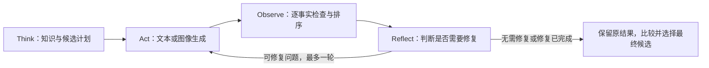

# TAOR / MMKGC

当前 MMKGC 五阶段多模态知识图谱补全代码。Stage 0 保存事实目录，Stage 1 知识建模、Stage 2
事实精选及 Stage 3 文本／图像提示词生成默认采用本地 Qwen2-VL-7B-Instruct，
Stage 4 的 GPT 评分采用 GPT-4o-mini。文本和图片分别通过 `text` / `image`
模式执行，均支持 Think → Act → Observe → Reflect 的一次有限反馈闭环。

集群首次接手请先阅读 [任务说明](docs/cluster-task-2026-11-02.zh.md) 和
[完整交接](docs/cluster-handoff-2026-11-02.zh.md)。集群尚未有源码时，可在新工作目录执行：

```bash
git clone --branch pipeline-refactor https://github.com/Roglic-SWQ/TAOR.git TAOR
cd TAOR
```

两份交接文档随实现基点 `74bcea4` 之后的文档提交提供。模型、真实数据、凭据和完整运行产物
需要另行准备；先核对现场资源与现有任务，再按任务书完成修复和单实体验证。

| 阶段 | 职责 |
| --- | --- |
| Stage 0 | 程序保存完整一跳事实目录，去重并保留方向，不调用 LLM 硬删关系 |
| Stage 1 | 图谱及各模态观察统一成三元组，Qwen3-Reranker-4B 按生成任务与语义身份相关性粗筛 |
| Stage 2 | LLM 选择一份有数量上限的共享事实集合，程序绑定证据和共同检查清单 |
| Stage 3 | 基于共享事实生成文本或协调图片的表达视角，SDXL 生成候选图像；接收定向修复反馈 |
| Stage 4 | GPT-4o-mini 逐事实观察，结合 CLIP、BLIP 等评分器排序；修复后再次评估 |

Stage 0 的完整一跳目录全部进入 Stage 1，取消新任务的 24 类关系／32 条图谱事实截断。
模型最多查看 32 条图谱身份示例，这只限制提示词，不限制程序保存的事实。统一建模后，
reranker 对全部事实分批计算任务相关性，默认选前 64 条送给 Stage 2；完整目录仍然保存。
可用 `--relevance-fact-budget` 或 Python API 的 `relevance_fact_budget` 调整本轮规划视图。
数据范围、来源与验证边界见
[Stage 0 证据选择](docs/stage0-evidence-selection.zh.md)。

Stage 2 默认使用 `shared_fact_selection_v1`：模型只返回状态和 `selected_fact_ids`，
一次选择一份事实集合，数量可以少于 `--max-selected-facts`（默认上限 64，不要求填满）。
未选事实仍保留在 Stage 1。事实选择与生成数量分开：文本默认生成一条完整描述，图片默认
使用 3 个生成尝试的运行预算，与正式图片批处理入口一致，可通过 `--candidate-budget` 调整。
Stage 3 读取相同事实和本轮先前提示词，协调表达重点，不分配 Stage 2 focus 或固定视角模板。
完全重复的提示词跳过图片生成，因此实际候选可以少于预算；未实现语义级去重或效果驱动早停。
所有候选使用共同事实参照；图片可选细节未展示与事实矛盾分别记录。旧计划仍可读取恢复。
格式或引用错误最多修正两轮，重复无效响应提前停止。协议与兼容边界见
[Stage 2 精简计划](docs/stage2-candidate-plan.zh.md)。

Stage 1 默认采用 `grounded_triples_v2`，统一保存 `subject / relation / object` 与来源引用。
图谱事实由程序原样带入，模型只返回实体简要身份、`extracted_triples` 和不确定项，
不再逐条改写图谱 claim，也不单独生成 attribute 或视觉档案。主谓宾完全相同的事实合并来源，
入边保留原始主语和宾语。文本、图片观察、视频帧／片段和音频转写／声音观察通过各自来源接入，
可保留文件、帧号、时间段等定位。已有原图使用两步建模：逐张看图生成独立描述，
再让模型同时读取各描述与对应原图，核对、补充并联合抽取三元组。每张图保留独立证据 ID，
完全相同的三元组合并全部来源。默认每批最多 4 张，超过时分批抽取后合并；
`configs/qwen7b-stage1.yaml` 的 `inference.stage1_image_batch_size` 控制批大小，
千问启动脚本通过 `QWEN_MAX_IMAGES_PER_PROMPT` 设置服务端图片上限（默认 4，修改后需重启服务）。
MKG-W 读取 `image_alignment` 图片索引，也支持 `images_by_id` 和旧版实体名称目录。
视频／音频也采用两步建模：
先根据原始画面与音轨／原音频生成描述，再结合描述与同一份媒体输入抽取三元组。
视频约每秒采一帧并保留完整主音轨，记录实际时间位置；短暂事件可能遗漏。
两步记录描述、媒体指纹和来源引用；生成描述不作为独立佐证，也不覆盖原始输入记录。
原始视频／音频需要 `ffmpeg`／`ffprobe` 和支持音频输入的 Stage 1 模型；默认 Qwen2-VL 不能听音频。
可用 `--stage1-model-config configs/media-stage1-api.yaml` 指定媒体模型，配置与限制见运行文档。
新流程不再运行事实与原证据的 rerank 对照；`relevance_score` 只表示任务用途相关性，不表示事实真假。
格式或引用错误最多额外修正两次，从原始输入重建完整回答，不回喂错误原文。
Stage 1 默认总时限 180 秒，初次请求、网络重试和业务修正共享；
Python API 可通过 `knowledge_stage_timeout_seconds` 调整。

Stage 2 每轮模型调用对超时、断连等瞬时故障默认重试一次，与业务修正分别计数，阶段总时限为 300 秒。
修正请求只携带原始输入与结构化错误，不回喂错误响应原文。
本地千问 Stage 3 遇到重复或截断时使用短请求、JSON 约束及有界重生成。

Stage 4 的 GPT 请求支持候选间并发，配置为 `max_concurrency: 10`。每实体
3 张候选图时实际最多并发 3 个评分请求。4／10／50 实体测试仍逐实体执行；
4580 实体补全脚本默认在 GPT 评分等待期间准备下一实体的 Stage 0–2，最多两个实体在途。
本地模型调用均在主线程顺序执行，避免同时占用 GPU。

Stage 3 的共享事实首轮提示词按顺序协调，后续请求读取此前已接受的表达。
独立候选的历史协议与修复请求支持 `inference.stage3_max_concurrency`；
千问主配置默认 3，保留的 GPT 对照配置为 5。SDXL 按候选顺序逐张生成图片。
千问配置中的 `inference.prompt_profile: qwen7b_original_v1` 用于兼容历史提示词。
新任务的统一三元组、共享事实选择及 Stage 3 文本／图片生成使用对应的新结构化提示词，
调用日志记录实际提示词版本与 `model_name`。Reflect 请求额外携带原内容和结构化修复上下文。

## Think → Act → Observe → Reflect

| 环节 | 当前实现 |
|---|---|
| Think | Stage 0–2：事实目录、知识建模、相关性 rerank 和共享事实选择 |
| Act | Stage 3：生成文本，或先生成图像 prompt 再由 SDXL 出图 |
| Observe | Stage 4：对照当前候选应表达的事实逐项检查，并进行质量排序 |
| Reflect | 根据具体观察条目修改原文本或 prompt，反馈到 Stage 3，最多一轮 |



每个候选的 `verification_targets` 来自自己的 `must_include` 和 `should_include`，
新共享事实流程中这些检查项由同一个事实集派生；图片可选细节未展示不会单独触发强制修复。
通过 `check_id`、`fact_id` 和 `evidence_refs` 关联到原计划和证据。Observe 在同一次
GPT 评分请求中返回逐项 `fact_checks`：

| 状态 | 含义 |
|---|---|
| `supported` | 候选表达了该事实，并提供内容证据 |
| `contradicted` | 候选与提供的事实明确冲突 |
| `missing` | 当前模态能够检查、内容足以判断，但未表达该事实 |
| `unverifiable` | 当前模态无法验证完整事实，例如仅凭建筑外观判断设计者 |
| `uncertain` | 画面模糊、遮挡或文字证据不足，暂时无法判断 |

`unsupported_claims` 另行记录提供的证据无法支持的新增断言。文本证据使用
`text:` 标记，图片使用 `pixel:` 标记。图片 Judge 查看实际生成图，CLIP / BLIP
提供匹配分数；文本另有三元组抽取和 KG 对齐。图片侧目前依赖视觉 Judge 的逐项
判断，尚未启用视觉关系图对齐。

Reflect 当前采用 `REPAIR_CONFIDENCE = 0.8`。当前最佳候选有高置信的直接事实冲突、
必需事实遗漏或无依据断言时，即使它已通过原有筛选，也可触发修复；没有合格候选时，
从存在可修复条目的候选中选择一个。推荐事实遗漏、无法验证和不确定不单独触发修复。

修复操作分别为 `replace`、`add`、`remove`，并保留已经确认的内容。修复请求包含
该候选自己的原文本或原 prompt、完整 observation、具体操作和允许使用的事实证据；
`replace` / `add` 必须有原计划的证据引用。图片修复会生成新的 positive prompt，
再由 SDXL 出图，沿用 Stage 2 已确定的事实计划。

修复后再次 Observe，并保留两个版本的记录。修复版本必须实际解决至少一个原问题、
保留此前确认的事实且不引入新的高置信冲突或无依据断言，才允许参与选择；
先比较同一候选两个版本的事实问题，再比较质量分数。生成、评估失败或修复退化时保留原结果。
该阈值尚未经过真实样本校准，实际检测与修复质量仍需模型实验验证。

完整字段、约束和实现边界见 [事实观察与定向修复](docs/fact-observation-reflection.zh.md)。

## 环境与资源

完整的双环境安装、模型目录、GPU 分配、自检及启动步骤见
[环境配置 README](README_ENV.md)。

开发环境为 Python 3.11、Torch 2.5.1 / CUDA 12.1、Transformers 4.51.3、
Diffusers 0.31.0。依赖统一放在 `requirements.txt`，包含 CUDA 12.1 版 Torch、
vLLM、生成与评分组件及测试工具：

```bash
python -m pip install -r requirements.txt
cp .env.example .env
```

在 `.env` 中填写 `OPENAI_API_KEY` 和所使用的兼容接口 `OPENAI_BASE_URL`。
配置文件使用环境变量，不包含凭据。

模型权重、数据集、基线实验目录和生成结果不包含在代码仓库中。按配置准备本地资源：

```text
datasets/MKG-W/                         # entity2id.txt、relation2id.txt、train.txt 等
Qwen/Qwen2-VL-7B-Instruct/              # Stage 0 / 1 / 2 / 3 本地语言模型服务
Qwen3-Reranker-4B/                      # Stage 1 任务相关性粗筛
SDXL/stable-diffusion-xl-base-1.0/       # 图像生成
CLIP/                                  # 本地 CLIP 权重
blip-itm-large-coco/                    # 本地 BLIP 图文匹配模型
Sentence-BERT/all-mpnet-base-v2/         # 文本任务评分
models/bertscore/roberta-large/         # 可选 BERTScore
```

`configs/stage4-model-fusion.yaml` 配置评分器及设备；
`configs/qwen7b-mainline.yaml` 配置 Stage 0 / 3，`configs/qwen7b-stage1.yaml`
配置 Stage 1 知识建模，`configs/qwen7b-stage2.yaml` 配置 Stage 2；
三者默认连接本机 12345 端口的千问服务。
`configs/openai-gpt4o-mini-judge.yaml` 配置 Stage 4 GPT 评分器，输出预算为
4096 token，用于容纳逐事实 Observe 结果。
`configs/gpt4omini-mainline.yaml` 保留为显式指定的 GPT 对照配置。
需要对照时可传 `--stage2-model-config configs/openai-gpt4o-mini-judge.yaml`；
4 / 10 / 50 实体脚本也支持 `STAGE2_MODEL_CONFIG` 覆盖。
Stage 2 千问通过普通生成接口输出 JSON，提示词列出完整输出模板；
本地执行候选数量、事实引用、来源证据校验及有界修正。

## 运行

先在单独终端启动千问服务：

```bash
bash scripts/run_qwen7b.sh
```

原缺图名单的 4580 实体补全，在另一个终端执行：

```bash
bash scripts/run_mkgw_image_completion_4580.sh
```

默认后台运行，每实体 3 张初始候选图；触发 Reflect 时可额外生成一张修复图。
任务保留五阶段结果、原候选与修复候选、调用日志和耗时，不复制原图。
使用 `--resume outputs/<任务名>` 断点续跑，使用 `--prepare-only` 只准备任务。
详细说明见 `docs/mkgw-missing-image-output-layout.zh.md`。

服务使用独立的 `.venv-qwen7b` 环境，安装步骤见运行环境文档。
下面示例中 `CUDA_VISIBLE_DEVICES=1` 将流水线模型放在物理 GPU 1，
千问服务默认使用物理 GPU 0。设备和数据路径应与本地环境一致。

```bash
CUDA_VISIBLE_DEVICES=1 python -m mmkgc.run \
  --dataset-dir datasets/MKG-W \
  --graph-split train \
  --missing-mode image \
  --limit 4 \
  --candidate-budget 5 \
  --stage1-reranker-device cuda:0 \
  --sdxl-device cuda:0 \
  --stage4-config configs/stage4-model-fusion-gpu1-visible.yaml \
  --continue-on-error \
  --output-root outputs \
  --run-name image_smoke
```

运行结果写入 `outputs/<run-name>/`。指定 `--continue-on-error` 时记录单个实体失败后
继续处理其他实体；存在失败时进程最终返回非零退出码。各参数见 `python -m mmkgc.run --help`。

查看 Observe / Reflect 结果时，进入实体目录，读取阶段 JSON 的 `data`：

| 文件 / 字段 | 内容 |
|---|---|
| `3_relation_alternation_generation.json` 的候选 `verification_targets` | 该候选的事实检查清单 |
| `4_kg_aware_candidate_consistency_ranking.json` 的 `text_ranking` / `image_ranking` → `ranked_candidates[].observation` | 逐事实结果及证据；含 `violated_facts`、`missing_facts`、`unverifiable_facts` |
| 同一阶段的 `stage3_regeneration.feedback.candidate_feedback` | 发生修复时的原内容、具体操作及来源证据 |
| 同一阶段的 `stage3_regeneration` | 修复次数、前后状态和候选 ID；失败时包含异常原因 |
| `ranking_model_calls.jsonl` | Judge 调用记录及绑定事实后的 observation |

修复候选使用 `text_safe_001` / `image_safe_001` 等 ID，通过 `source_candidate_id`
关联原候选。`observation_version` 当前为 `fact_observation_v1`。

## 验证

```bash
python -m pip install -r requirements.txt
PYTHONDONTWRITEBYTECODE=1 python -m pytest -q -p no:cacheprovider \
  tests/test_fact_observation.py \
  tests/test_stage3_feedback.py \
  tests/test_grounded_model_mainline.py \
  tests/test_prompt_v2.py \
  tests/test_qwen7b_original_prompts.py \
  tests/test_stage3_concurrency.py \
  tests/test_judge_concurrency.py \
  tests/test_ranking_image_transport.py \
  tests/test_entity_pipeline.py \
  tests/test_single_mainline_contract.py

PYTHONDONTWRITEBYTECODE=1 python -m pytest -q -p no:cacheprovider \
  tests/test_ranking_gpt4omini_judge.py -k gpt4omini_parser
```

2026-10-30，上述两组相关离线测试分别为 173 项和 20 项，合计 193 项通过，
覆盖逐事实观察、反馈隔离、必需遗漏、不可验证关系、修复退化、失败保留、千问提示词
及并发/流水线接口。测试使用模拟模型响应，未运行真实 GPT、千问或 SDXL 生成。
仓库还保留较早接口的测试，部分旧测试尚未适配当前主流程；该记录不代表全部测试通过。

旧角色／槽位协议的 Stage 2 千问加入定向修正后，7 个实体重新规划全部通过；先前版本为 4/7。
该历史验证未运行其余四阶段，也未重跑全部 50 个实体，不代表新候选协议的实测效果。
结果和限制见 [Stage 2 定向修正验证](docs/evaluation/2026-10-28-stage2-qwen-targeted-repair.zh.md)。

## 文档

- [从零配置与启动](README_ENV.md)
- [运行环境与并发设置](docs/stage1-stage2-runtime.zh.md)
- [事实观察与定向修复](docs/fact-observation-reflection.zh.md)
- [TAOR 方法章节草稿](docs/think-act-observe-reflect-method.zh.md)
- [批量补全输出与断点恢复](docs/mkgw-missing-image-output-layout.zh.md)
- [千问 7B 原始提示词](docs/qwen7b-original-prompts.zh.md)
- [GPT 对照提示词 v2](docs/gpt4omini-prompts-v2.zh.md)
- [Stage 2 契约与修正反馈](docs/evaluation/2026-10-27-stage2-contract-v2.zh.md)
- [Stage 1 事实 ID 完整性修正](docs/evaluation/2026-10-27-stage1-fact-id-repair.zh.md)
- [8 个失败实体的网络与生成恢复优化](docs/evaluation/2026-10-28-failed8-recovery.zh.md)
- [Stage 2 切换千问 7B](docs/evaluation/2026-10-28-stage2-qwen7b.zh.md)
- [千问 Stage 2 定向修正](docs/evaluation/2026-10-28-stage2-qwen-targeted-repair.zh.md)

`docs/evaluation/` 保留按日期记录的实验报告、结果和固定样本总名单。
其中包含旧版流程的历史实验，应按记录日期解读；当前运行方式以本 README 和代码为准。

本仓库保存当前工作代码快照；本地实验日志、运行产物和第三方模型资源单独管理。
