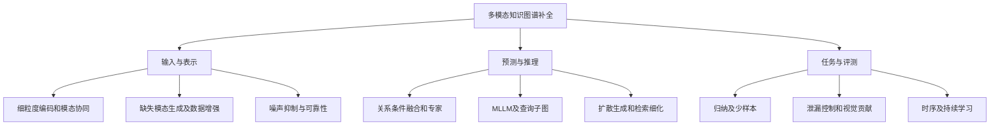

**多模态知识图谱近期研究调研报告——面向硕士论文双创新点选题**

调研截止：2026 年 11 月 3 日（北京时间）。重点时间窗：2025 年至截止日，补充 2024 年必要代表作。报告对象：以 MMKGC 为第一项研究工作的硕士论文选题。正文中的 [Rxx] 对应末尾参考文献；原文地址、代码入口、发表状态、核读深度保存在配套 CSV 和 JSON 文献表中。

**调研结论。** 近期工作已从整体模态融合，扩展到细粒度表示、缺失与噪声鲁棒性、生成增强、MLLM 推理、归纳/少样本预测和评测可信性。对你的选题最重要的变化是：生成图片辅助补全、关系条件融合、可靠性估计、查询子图推理、困难候选区分，都已经存在直接相关工作。两项创新点应在这些既有方法上界定具体机制与验证条件，不能仅用概念组合证明新颖性。[R04–R22, R32–R33]

本报告整理 33 项代表性文献，含综述、研究论文和基准。它是面向选题的定向调研，不是穷尽式系统综述。检索以 ACL Anthology、CVF、NeurIPS 官方论文集、AAAI、出版社、作者预印本及作者代码仓库为主；第三方转载不作为方法结论的证据。对重点文献核读方法/实验节，对部分新论文仅核验官方摘要与元数据；核读深度逐项列入文献表。未运行外部模型或复现实验。

**首先需要统一任务边界。** 同样使用图像、文本和知识图谱的工作，预测目标可能不同；它们可以互相借鉴，但不能混作同一排行榜。[R01, R07, R23, R26–R30]

| 任务 | 输入与输出 | 与你的论文的关系 |
|---|---|---|
| 多模态知识图谱补全 MMKGC | 结构与实体模态 → 缺失三元组/实体排名 | 两项研究的共同主任务 |
| 缺失模态补全 MMC | 已有模态与证据 → 图片、文本或模态特征 | 第一项的直接技术任务；还需下游 KGC 验证 |
| 多模态实体对齐 MMEA | 两张图谱及其模态 → 同一实体匹配 | 可借鉴噪声处理和校准；不是链接预测 |
| 多模态图谱构建 | 原始资料 → 节点、关系与来源记录 | 可支持证据获取；构建质量不等于补全质量 |
| 多模态 KGQA / GraphRAG | 查询、图谱和媒体 → 答案或解释 | 可借鉴证据检索；QA 准确率不能替代 KGC 指标 |
| 时序事件预测 | 截止时刻前的信息 → 未来事实 | 必须按时间隔离证据，不能套用静态随机划分 |
| 持续多模态图谱推理 | 多个顺序到达的图谱快照 → 持续预测 | 第二项的可选扩展；涉及遗忘与更新成本 |

**研究路线可以按“信息在哪里起作用”来理解。** 下图是本报告的归纳，不代表所有论文都沿同一路线演进。

**表示与融合方向已经形成较密集的方法积累。** 第一项创新点若只强调“引入图谱”“加入注意力”或“结合多个评分器”，区别会偏弱；第二项若只添加关系门控，也容易与下列工作重合。

| 文献 | 已有方法重点 | 对选题的约束 |
|---|---|---|
| LAFA，AAAI 2024 [R02] | 链接相关的融合与聚合 | 查询/关系影响模态利用不是新问题 |
| SNAG，COLING 2025 [R03] | 用噪声驱动鲁棒表示，覆盖补全和对齐 | 随机噪声、模态遮蔽需作为基础对照 |
| MyGO，AAAI 2025 [R04] | 多模态 token 化、细粒度交互和增强 | 不能将 token 级融合本身作为充分创新 |
| MoMoK，ICLR 2025 [R05] | 关系条件的模态专家、专家知识解耦 | “关系＋专家网络”已有代表作 |
| Moodle，NAACL Findings 2025 [R06] | 模态间协同学习与知识传递 | 跨模态互教和协同训练需明确新增机制 |
| M-Hyper，ACL 2026 [R11] | 保留独立模态表示，同时建模融合和交互 | 需对比其关系感知融合，不能只与简单拼接比较 |
| MDBGF，ACL Findings 2026 [R12] | 动态模态丢弃、双向门控与混合负采样 | 模态缺失鲁棒性需要强基线 |
| DVMKG，EMNLP Findings 2025 [R10] | 按实体需求和图像代表性/多样性利用视觉 | 图片数量和视觉必要性应分别验证 |
| CoMu，在线 2026 [R13] | 根据移除模态前后的预测变化调整融合 | 仅做模态消融驱动权重，创新边界较窄 |
| ReTree，KBS 2026 [R14] | 关系级可靠性、局部候选区分与层级记忆 | “可靠性＋困难候选区分”已有直接工作 |

我的判断是：这个方向仍有研究空间，但更有价值的问题是可靠性在什么条件下成立、来源依赖怎样影响预测、或训练和测试缺失模式不一致时怎样适应。不能把“融合权重高”直接解释成“证据可信”，也不能把移除模态后的模型变化自动解释为现实世界因果效应；这些解释都需要额外定义和实验。[R10, R13–R14]

**缺失模态与生成增强，是与你第一项工作最接近的一组研究。** 阅读时要区分原始内容生成、潜在特征生成和实体答案生成。

| 文献 | 生成/增强对象 | 与当前项目的直接关系 |
|---|---|---|
| Knowledge Bridger，CVPR 2025 [R07] | 缺失图片/文本等模态内容 | 当前项目的基础范式：知识建模、生成与排序 |
| LBMKGC，NeurIPS 2025 [R09] | 用 SDXL 补充视觉，再对齐和融合 | 第一项必须重点比较的直接 MMKGC 方法 |
| Beyond Images，ESWC 2026 [R22] | 补充图像、图像描述与文本汇总 | 增强数据本身可能产生收益，需控制资源与编码器 |
| DuPLeR，2026 公开稿 [R19] | 少样本任务中的类型与模态增强 | “生成增强＋归纳预测”已有相关探索 |
| DHNS，DASFAA 2025 [R08] | 用扩散生成困难负实体嵌入 | 是训练策略，不能当作 SDXL 图像补全方法 |
| DiffusionCom，2025 公开稿 [R16] | 结构条件下的潜在表示/实体预测分布 | 是生成式补全模型，不是恢复原始图片 |
| MGDT，2026 公开稿 [R18] | MLLM 对齐后进行扩散式尾实体预测 | “MLLM＋扩散”需要区分对齐目标和生成目标 |
| RADD，2026 公开稿 [R32] | 检索分布锚定的离散扩散预测 | 已针对检索漏召回和候选细粒度歧义提出方案 |

对第一项最关键的是 LBMKGC。它已结合 SDXL 模态增强、跨模态对齐和上下文融合。因此，“生成图片能够改善 MMKGC”不足以单独作为你的创新表述；应突出生成全过程中事实可追溯、生成内容可核验、定向修复能产生额外下游收益等可证实的增量。[R09]

LBMKGC 原文表 2 给出了以下消融结果。为便于理解，MRR 从原文的乘 100 表示换算为 0–1；这是该论文内部对照，不是本报告复现结果。[R09, 表 2]

| 数据集 | 完整模型 MRR | 去掉 LvMC 生成模块 | MRR 绝对差 |
|---|---:|---:|---:|
| DB15K | 0.3723 | 0.3673 | +0.0050 |
| MKG-W | 0.3846 | 0.3712 | +0.0134 |
| MKG-Y | 0.4003 | 0.3940 | +0.0063 |

这个结果说明应单独量化生成环节的贡献。论文整体模型的提升不能全部归因于生成；也不能据此推断你的多候选事实检查一定有效。你需要保持骨干、编码器和训练预算一致，比较简单提示生成、Knowledge Bridger、你的事实约束生成，以及去掉修复的版本。

Beyond Images 则提醒另一项实验问题：额外图像和更丰富的文本也可能改善表示。若你的方法获得更多资料，而基线沿用旧特征，性能差异会同时包含数据资源差异；应补充共享数据资源的对照。[R22]

**大模型正在从编码器转向推理组件，但“把证据交给 LLM”已经不是充分区别。**

| 文献 | 已有设计 | 需检查的实验边界 |
|---|---|---|
| ELMM，2025 公开稿 [R17] | 压缩视觉 token、裁剪注意力，构建轻量 MLLM 补全模型 | 训练/推理成本、性能与模型规模的关系 |
| ViSR-KGC，2026 公开稿 [R20] | 查询相关子图与视觉语言模型联合推理 | 子图是否含目标边、候选和全实体评测是否一致 |
| DuPLeR，2026 公开稿 [R19] | 类型先验、事实结构和双路径推理，用于多模态少样本补全 | support/query、未见实体与外部知识的边界 |
| RMKGC，KBS 2026 [R33] | LLM 生成理由，引导交互与解耦推理 | 生成理由是否忠于输入、是否包含未授权事实 |
| RADD，2026 公开稿 [R32] | 将检索不确定性用于多模态预测细化 | 正确答案不在候选集合时是否仍能预测 |

我此前建议的“候选差异证据推理”需要收紧。ReTree 已处理局部候选可分性，RADD 已处理检索覆盖与候选歧义，ViSR-KGC 已使用查询子图。更具体的候选切口可以是：在受控证据预算下，验证证据删除、替换或冲突对排序的作用；但这仍只是待验证假设，不能据本次调研宣称现有研究没有覆盖。[R14, R20, R32]

**评测可信性值得作为整篇论文的共同基础。** ArtKGC 已将图谱泄漏、原始文本直接披露答案、实体映射歧义和未见艺术品预测纳入协议设计，并显示视觉证据的作用具有关系差异。[R15] 这对你的两项工作都有直接意义：应说明模型依赖的是已有图谱、原始媒体，还是外部大模型中不可审计的先验。

这里要区分两种情况：允许原始文本包含答案的应用任务，并不自动等同于数据使用违规；但它可能不足以检验关系推理。若论文要证明“推理能力”或“补全泛化”，应另设受控文本和目标事实屏蔽条件，并清楚报告二者结果。不能简单把所有文本答案线索都称为泄漏。

**补全之外的近期工作，可以提供方法和任务扩展，但需要保持评价目标清楚。**

| 文献 | 研究方向 | 对你的潜在启发 |
|---|---|---|
| NMMEA / CrossEA，COLING 2025 [R23] | 图像实体节点参与的原生多模态对齐 | 区分“模态属性”与“独立多模态节点”的图建模 |
| RICEA，ACL 2025 [R24] | 相对交互和不确定性校准的实体对齐 | 可借鉴校准方法，需重新验证链接预测目标 |
| LGEA，EMNLP 2025 [R25] | LLM 过滤图像噪声、增强属性语义 | 将数据清理收益与模型结构收益分开 |
| RULE，ICLR 2026 [R29] | 实体-属性和跨图对应的双层噪声 | 噪声可能发生在对应关系，而不仅是向量扰动 |
| UKnow，NeurIPS 2024 [R26] | 统一多粒度、多来源知识组织 | 证据来源组织可借鉴，任务不局限于 KGC |
| MM-Graph，CVPR 2025 [R27] | 多模态图学习基准 | 一般图学习的证据不能直接替代关系补全实验 |
| MMKG-R1，2026 公开稿 [R21] | 图质量驱动的 RL 图谱构建 | 构建过程可学习；主要下游 QA 需另行评价 |
| HOME-KGQA，LREC 2026 [R30] | 家庭活动的多模态时空、多跳问答 | 真实场景中的时间和多跳证据组织 |
| DyMRL，WWW 2026 [R28] | 动态多空间表示用于多模态事件预测 | 将“未来事实”与“静态缺边”区分 |
| MRCKG，2026 公开稿 [R31] | 持续学习、跨模态保持与回放 | 增量实体/模态场景值得关注，但已有直接工作 |

本次代表样本中，直接 MMKGC 的主要实验仍以结构、文本和图像为主。音视频接口支持本身不能证明音视频补全方法有效；如果你扩展到这些模态，需要找到具有真实链接预测标注的数据与相应比较对象。这个判断是针对本报告纳入样本，不能扩展成“领域中没有音视频研究”。

**结合当前 MMKGC 项目，第一项工作的贡献应重新对齐直接竞争方法。** 本报告核对了项目 README、完整事实目录与来源说明、逐事实观察文档、下游特征构建和 M-Hyper 子集评测脚本。当前工作基础包括：训练图谱事实与媒体来源绑定、统一三元组、任务相关性筛选、共享事实计划、多候选生成、逐事实观察及有限定向修复。

在论文中可将第一项暂时表述为“知识证据约束与定向反思驱动的多模态知识图谱补全增强”。相对 Knowledge Bridger 与 LBMKGC，重点验证：

1. 固定数据资源和候选预算后，事实选择能否提高补全效果。
2. 逐事实核验是否比整体相似度排序更能预测生成内容的下游价值。
3. 定向修复是否优于同等预算的随机重生成。
4. 生成收益能否迁移到两个结构不同的补全骨干。

项目已有接口、通过 mock 的测试、生成质量、下游效益是不同层次的证据。当前文档中部分检查明确只覆盖接口或模拟响应，因此不能将其写成真实模型实验结论。原图缺失还要明确是文件缺失、索引失配，还是 benchmark 模态确实缺失；这些集合可能不同。

你已有将 CLIP 特征映射到 M-Hyper 特征空间的脚本。它有利于接入，但映射误差也可能影响结果。建议增补统一编码器条件；如继续使用映射，应说明拟合实体范围，排除隐藏目标模态，并在各方法间共用同一映射过程。

**第二项的选题应在可复用性与独立贡献之间取平衡。** 以下是本报告根据文献和项目基础给出的研究建议，均不是已证明的新颖结论。

| 候选方向 | 可检验研究问题 | 必须直接比较的文献 | 对你当前项目的适配判断 |
|---|---|---|---|
| A. 冲突证据条件下的多模态补全 | 图谱、文本、图片明确冲突时，能否定位相关事实并控制错误预测？ | DVMKG、CoMu、ReTree、ArtKGC | 优先做问题验证；可复用事实观察，第二项能独立运行 |
| B. 未见实体与缺失模式迁移 | 训练和测试实体/模态可用模式不一致时，哪些证据能支持迁移？ | MDBGF、ReTree、DuPLeR | 两项都面向信息不完备；数据划分与基线成本较高 |
| C. 持续更新的多模态补全 | 新实体或新模态到达后，能否提升新知识预测且减少遗忘？ | MRCKG、DyMRL | 与第一项边界清晰，但需要时间快照或合理流式协议 |

A 的具体实验可保持实体内容大体相似，分别引入错误图片对应、冲突文本属性或错误邻域事实，并记录被修改的来源。模型需区分明确矛盾、未支持和不可判断；结构化事实的支持/反驳表示与修复后的反事实排序变化，可以成为候选机制。自然噪声和受控扰动应分别报告。若质量分数加权已能解决问题，就应承认复杂机制缺少必要性。

B 可以研究新实体只有部分模态、或生成模态与观测模态混合的情况。来源信息在这里更可能具有明确作用，但不能仅加入二元来源标签；应验证训练/测试来源分布变化下的贡献，并与相同参数规模的普通门控比较。生成内容的来源记录也不等于完整因果溯源。

C 适合你希望第二项与第一项更独立时考虑，但不应只给静态模型增加一次 replay。应定义结构和模态各自到达、旧知识保持与更新时间的关系。MRCKG 已经研究持续多模态推理，因此还需进一步收敛，例如模态迟到与结构更新不同步；此类切口仍需要补充定向检索。

我的当前建议是：先用现有模型验证 A 中“冲突能否被定位、简单加权是否足够”的问题，再决定是否进入方法开发。如果导师偏向归纳泛化，优先评估 B；C 的任务和数据工作量最大。以上排序是工程可行性判断，不代表学术新颖性或录用保证。

**实验协议应统一后再比较方法。** 建议保留经典公开 benchmark，同时增加一个能够检验研究问题的受控条件。不要把所有新论文分数拼成一张 SOTA 总榜：编码器、额外数据、实体划分、候选范围和外部模型都可能不同。

| 实验维度 | 建议设置 | 需要说明的原因 |
|---|---|---|
| 主数据集 | MKG-W；再选 MKG-Y 或 DB15K | 至少检验跨数据集可迁移性 |
| 结构基线 | 一个纯结构模型 | 判断模态究竟增加了什么 |
| 表示基线 | MyGO、M-Hyper；按资源选择 SNAG/MoMoK | 覆盖细粒度、鲁棒性和专家路线 |
| 生成基线 | Knowledge Bridger、LBMKGC、简单提示生成 | 第一项的直接对照 |
| 可靠性基线 | DVMKG、CoMu、ReTree；按任务适用性选择 | 不把已有成熟问题重新包装 |
| 目标事实边界 | train 证据生成；内部留出任务同步屏蔽目标边、逆边和派生引用 | 避免先写入答案再评价补全 |
| 候选范围 | 全实体或明确的候选协议；同时报告 Recall@K | 重排序的收益受召回上限约束 |
| 外部信息 | 统一文本、图片、编码器和模型条件；额外资料单列 | 区分方法贡献与资源贡献 |
| 缺失与噪声 | 自然缺失、固定随机遮蔽、针对性冲突分别评价 | 三者对应不同分布 |
| 评价 | filtered MRR、Hits@1/3/10、缺失相关子集、关系分组 | 总体均值可能掩盖退化 |
| 稳定性与成本 | 多随机种子、波动范围、生成成本、推理延迟 | 判断收益能否稳定复现 |

这里的目标边屏蔽尤其适用于“用训练内部留出样本产生生成内容或辅助监督”的实验，不意味着普通监督训练不能使用训练标签。官方测试集中的已知真事实用于 filtered 指标计算，也不等同于允许将其输入生成或检索模型。

两项工作的贡献可用 2×2 实验分离：原始数据/第一项增强数据，分别接基础补全模型/第二项模型。第二项还应在原始数据上独立验证。若只报告最终组合优于最弱基线，难以判断两项方法各自作用。

**建议按研究决策排序阅读。** 第一轮优先读 R09、R07、R11、R10、R14、R15、R32、R33，分别回答生成是否已有、骨干强度、视觉必要性、可靠性、评测边界、检索覆盖与 LLM 理由推理。第二轮补 R04–R06、R12–R13、R19–R20，进一步确认具体方法差异。第三轮再按选题阅读实体对齐、构建、时序与持续学习文献。

建议先完成三张内部表：第一项相对 KB/LBMKGC 的模块差异；第二项相对 ReTree/CoMu/RADD/ViSR 的问题差异；全部实验的数据与证据可见性。每一项声称的贡献都应对应至少一个能否证它的对照实验。

**发表日期和资料边界需要保留。** CoMu 的卷期是 2027 年 2 月，但已在 2026 年 10 月 12 日在线发表，故属于截止日前可见研究。ViSR-KGC 与 MRCKG 的公开稿标注 ACM MM 2026，而稿件中的会议日期是 2026 年 11 月 10–14 日；本报告主要按公开稿引用，不把会议描述为截至 11 月 3 日已经举行。对其他仅核验 arXiv 的条目，不据模板或作者宣传补写正式会议信息。对 ReTree/RMKGC 等仅能取得出版社摘要与引言的条目，不报告未核实的实验数字。

正式写论文时，作者全名、页码和出版年应从最终出版记录再次导出；尤其不能将预印本和正式版重复计数。下列参考文献为定位条目，配套文献表保留全部一手入口和本轮核读深度。

**参考文献。**

[R01] Zhuo Chen et al. Knowledge Graphs for Multi-modal Learning: Survey and Perspective. Information Fusion 121:103124, 2025. 标识：10.1016/j.inffus.2025.103124。期刊正式发表。

[R02] Bin Shang et al. LAFA: Multimodal Knowledge Graph Completion with Link Aware Fusion and Aggregation. AAAI 2024, 2024. 标识：10.1609/aaai.v38i8.28744。会议正式发表。

[R03] Zhuo Chen et al. Noise-powered Multi-modal Knowledge Graph Representation Framework. COLING 2025, 2025. 标识：2025.coling-main.11; arXiv:2403.06832。会议正式发表。

[R04] Yichi Zhang et al. Tokenization, Fusion, and Augmentation: Towards Fine-grained Multi-modal Entity Representation. AAAI 2025, 2025. 标识：10.1609/aaai.v39i12.33454。会议正式发表。

[R05] Yichi Zhang et al. Multiple Heads are Better than One: Mixture of Modality Knowledge Experts for Entity Representation Learning. ICLR 2025, 2025. 标识：arXiv:2405.16869; OpenReview:ue1Tt3h1VC。作者官方仓库确认会议；OpenReview入口受限。

[R06] Guoliang Zhu et al. Let Modalities Teach Each Other: Modal-Collaborative Knowledge Extraction and Fusion for Multimodal Knowledge Graph Completion. Findings of NAACL 2025, 2025. 标识：10.18653/v1/2025.findings-naacl.346。会议正式发表。

[R07] Guanzhou Ke et al. Knowledge Bridger: Towards Training-Free Missing Modality Completion. CVPR 2025, 2025. 标识：CVPR 2025 pp.25864–25873; arXiv:2502.19834。会议正式发表。

[R08] Guanglin Niu and Xiaowei Zhang Diffusion-based Hierarchical Negative Sampling for Multimodal Knowledge Graph Completion. DASFAA 2025, 2025. 标识：arXiv:2501.15393。arXiv作者记录声明DASFAA 2025录用。

[R09] Yuan Guo et al. LBMKGC: Large Model-Driven Balanced Multimodal Knowledge Graph Completion. NeurIPS 2025 Main Conference, 2025. 标识：10.52202/085713-3736。会议正式发表。

[R10] Minghang Liu et al. Differentiated Vision: Unveiling Entity-Specific Visual Modality Requirements for Multimodal Knowledge Graph. Findings of EMNLP 2025, 2025. 标识：10.18653/v1/2025.findings-emnlp.1097。会议正式发表。

[R11] Zhiqiang Liu et al. Collaboration of Fusion and Independence: Hypercomplex-driven Robust Multi-Modal Knowledge Graph Completion. ACL 2026 Main Conference, 2026. 标识：10.18653/v1/2026.acl-long.1289。会议正式发表。

[R12] Jiashun Peng et al. Not All Modalities at Once: Dynamic Dropout and Bidirectional Fusion for Robust Multi-modal Knowledge Graph Completion. Findings of ACL 2026, 2026. 标识：10.18653/v1/2026.findings-acl.890。会议正式发表。

[R13] Bin Chen et al. Taming modality bias with counterfactual reasoning in multimodal knowledge graph completion. Neural Networks 206(Pt A):109745, 2027. 标识：10.1016/j.neunet.2026.109745。已于2026年在线发表；卷期为2027年2月。

[R14] Jingchao Wang et al. Beyond modality importance: Reliability-guided tree memory for inductive multimodal knowledge graph completion. Knowledge-Based Systems 352(A):116953, 2026. 标识：10.1016/j.knosys.2026.116953。期刊正式发表。

[R15] Xuan Zhou et al. ARTKGC: Leakage-Controlled Multimodal Knowledge Graph Completion for Artwork Explanation. Findings of EMNLP 2026, 2026. 标识：2026.findings-emnlp.2299。官方论文集已列出。

[R16] Wei Huang et al. DiffusionCom: Structure-Aware Multimodal Diffusion Model for Multimodal Knowledge Graph Completion. arXiv公开稿, 2025. 标识：arXiv:2504.06543。正式发表状态本轮未核实。

[R17] Wei Huang et al. ELMM: Efficient Lightweight Multimodal Large Language Models for Multimodal Knowledge Graph Completion. arXiv公开稿, 2025. 标识：arXiv:2510.16753。正式发表状态本轮未核实。

[R18] Xu Hou et al. MGDT: MLLM-Guided Diffusion Transformer with Relation-Adaptive Mixture-of-Experts for Multimodal Knowledge Graph Completion. arXiv公开稿, 2026. 标识：arXiv:2607.15592。按公开预印本引用；未独立核验会议出版。

[R19] Jinlan Liu et al. Dual-Path LLM Reasoning for Multimodal Few-Shot Knowledge Graph Completion. arXiv公开稿, 2026. 标识：arXiv:2607.26909。正式发表状态本轮未核实。

[R20] Jiafan Li et al. ViSR-KGC: Visual Subgraph Reasoning with Vision-Language Models for Multimodal Knowledge Graph Completion. arXiv公开稿；稿件标注ACM MM 2026, 2026. 标识：arXiv:2608.05833; 稿件DOI:10.1145/3767308.3836133。按截止日前公开稿引用；会议日期尚在未来。

[R21] Zongyu Wu et al. MMKG-R1: Constructing Multimodal Knowledge Graphs via Reinforcement Learning. arXiv公开稿, 2026. 标识：arXiv:2610.19341。正式发表状态本轮未核实。

[R22] Pengyu Zhang et al. Are a Thousand Words Better Than a Single Picture? Beyond Images - A Framework for Multi-modal Knowledge Graph Dataset Enrichment. ESWC 2026, 2026. 标识：10.1007/978-3-032-25156-5_5; arXiv:2603.16974。会议论文已正式在线发表。

[R23] GuanChen Xiao et al. Multi-Modal Entities Matter: Benchmarking Multi-Modal Entity Alignment. COLING 2025, 2025. 标识：2025.coling-main.582。会议正式发表。

[R24] Chenxiao Li et al. Probing Relative Interaction and Dynamic Calibration in Multi-modal Entity Alignment. ACL 2025, 2025. 标识：10.18653/v1/2025.acl-long.1384。会议正式发表。

[R25] Chenglong Lu et al. Breaking the Noise Barrier: LLM-Guided Semantic Filtering and Enhancement for Multi-Modal Entity Alignment. EMNLP 2025, 2025. 标识：10.18653/v1/2025.emnlp-main.1684。会议正式发表。

[R26] Biao Gong et al. UKnow: A Unified Knowledge Protocol with Multimodal Knowledge Graph Datasets for Reasoning and Vision-Language Pre-Training. NeurIPS 2024 Datasets and Benchmarks, 2024. 标识：10.52202/079017-0306。会议正式发表。

[R27] Jing Zhu et al. Mosaic of Modalities: A Comprehensive Benchmark for Multimodal Graph Learning. CVPR 2025, 2025. 标识：arXiv:2406.16321。作者项目页确认会议。

[R28] Feng Zhao et al. DyMRL: Dynamic Multispace Representation Learning for Multimodal Event Forecasting in Knowledge Graph. WWW 2026, 2026. 标识：arXiv:2603.24636; 10.1145/3774904.3792600。作者代码仓库确认会议；预印本可访问。

[R29] Haobin Li et al. Learning with Dual-level Noisy Correspondence for Multi-modal Entity Alignment. ICLR 2026, 2026. 标识：arXiv:2510.18240。作者最终论文及官方仓库确认。

[R30] Shusaku Egami et al. HOME-KGQA: A Benchmark Dataset for Multimodal Knowledge Graph Question Answering on Household Daily Activities. LREC 2026, 2026. 标识：10.63317/25xhew5rnydb。会议正式发表。

[R31] Linyu Li et al. When Modalities Remember: Continual Learning for Multimodal Knowledge Graphs. arXiv公开稿；稿件标注ACM MM 2026, 2026. 标识：arXiv:2604.02778; 稿件DOI:10.1145/3767308.3836401。按截止日前公开稿引用；会议日期尚在未来。

[R32] Guanglin Niu and Bo Li RADD: Retrieval-Anchored Discrete Diffusion for Multi-Modal Knowledge Graph Completion. arXiv公开稿, 2026. 标识：arXiv:2604.25693v3。正式发表状态本轮未核实。

[R33] Linjia Hao et al. RMKGC: Rationale-Guided Reasoning with LLM for Multimodal Knowledge Graph Completion. Knowledge-Based Systems 352(C):117091, 2026. 标识：10.1016/j.knosys.2026.117091。期刊正式发表。

**本地项目依据。** 本报告只新增调研文件，未修改既有模型、配置、运行任务或实验结果。项目事实依据为 MMKGC/README.md、docs/stage0-evidence-selection.zh.md、docs/fact-observation-reflection.zh.md、scripts/build_mhyper_official_space_features.py 和 scripts/evaluate_mhyper_subset.py。

